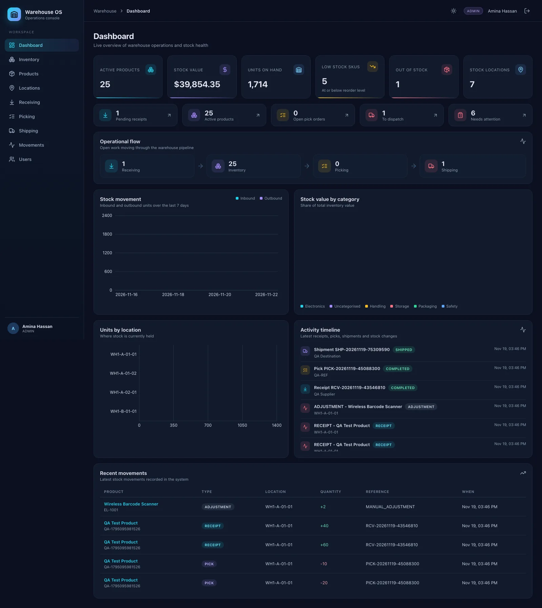
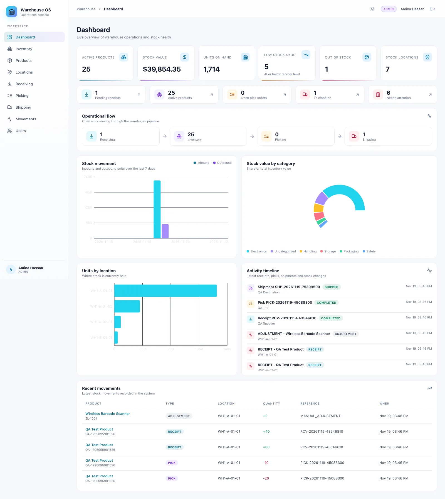
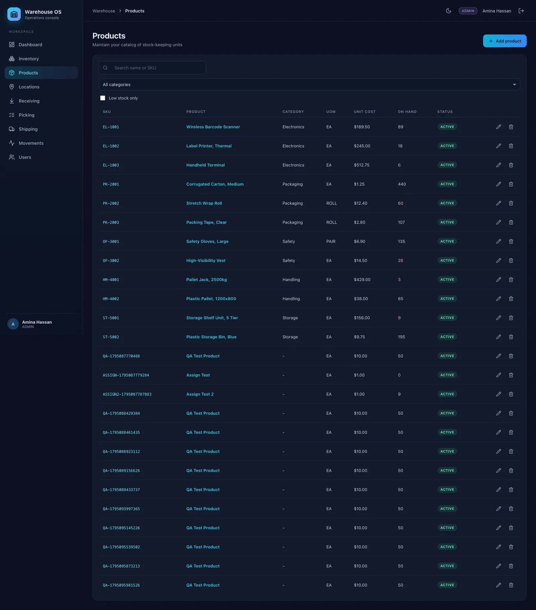
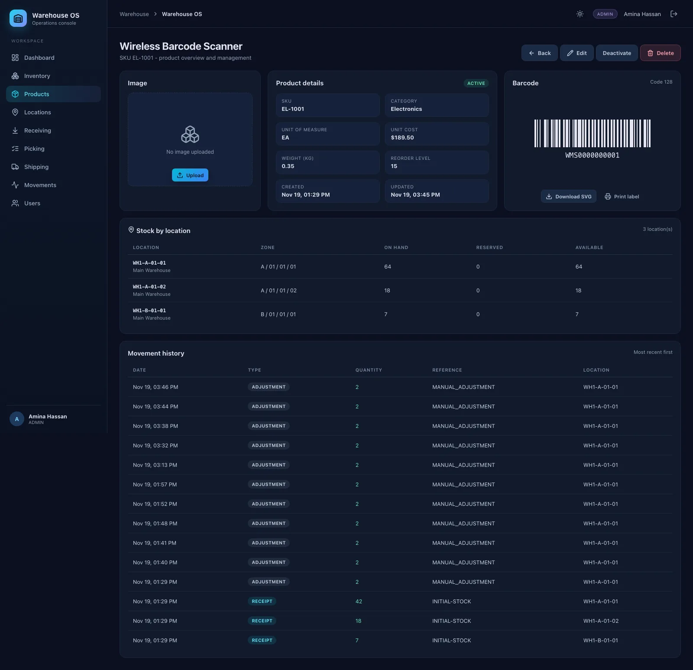
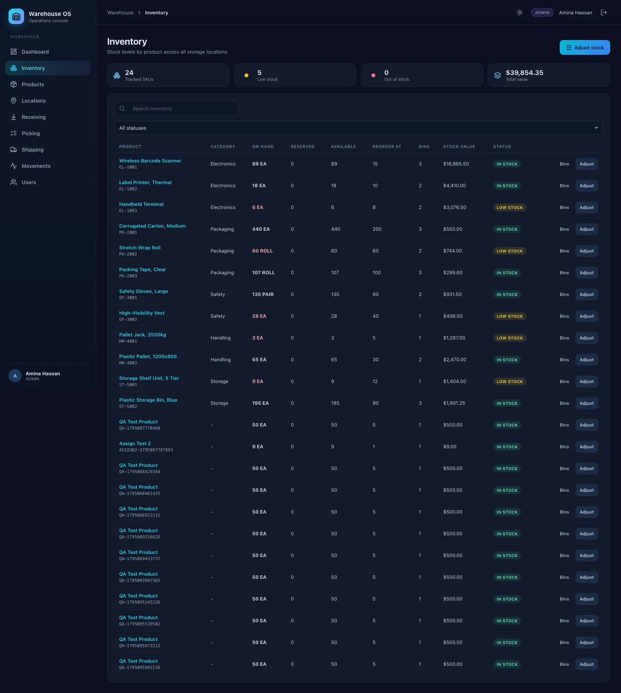
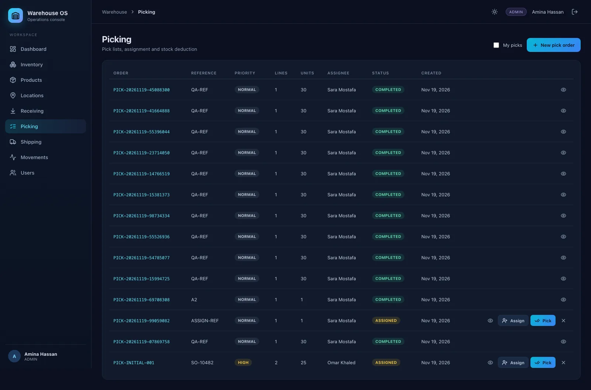

# Warehouse OS

[](https://azzazy967.github.io/warehouse-os/)
[](LICENSE)

A full core Warehouse Management System (WMS): a NestJS REST API with role-based auth and a React admin UI. It covers inventory, products, locations, receiving, picking, shipping, stock movements, and a dashboard. Free, open source and self-hosted.

**Project site:** https://azzazy967.github.io/warehouse-os/

## Screenshots

Dashboard (dark) | Dashboard (light)
--- | ---
 | 

Products | Product detail
--- | ---
 | 

Inventory | Picking
--- | ---
 | 

- **Backend:** NestJS 10 + TypeORM 0.3, JWT/Passport auth, bcrypt, class-validator.
- **Frontend:** React 18 + Vite 6 + TypeScript (strict), Recharts, Lucide icons.
- **Database:** PostgreSQL for production, SQLite for zero-dependency local development.

---

## Features

- **Inventory** — live stock per product/location, summary with available/stock-value/status, guarded manual adjustments.
- **Products & Locations** — full CRUD, categories/warehouses/zones, deletion guards when records are in use.
- **Product detail page** — click any product across the app to open its own page with uploaded images, an auto-generated Code 128 barcode (downloadable SVG and printable label), stock by location, movement history, and inline management for ADMIN/MANAGER.
- **Receiving** — create inbound orders, partial receive with accumulative quantities, over-receive blocking.
- **Picking** — assign to a picker, partial picks, over-pick blocking, stock deducted across bins (largest available first, reserved units untouched).
- **Shipping** — create shipments, ship/deliver transitions, double-ship protection.
- **Stock movements** — immutable audit trail for every stock change, filterable by product/type/date.
- **Dashboard** — clickable KPI cards with drill-downs, operational flow diagram, 7-day inbound/outbound chart, stock-value-by-category and units-by-location charts, activity timeline, recent movements.
- **Auth & roles** — JWT login, rate limiting, three roles (ADMIN / MANAGER / PICKER) enforced on both API and UI.

UI is English only and uses Lucide icons exclusively (no emojis). A Dark/Light mode toggle in the header (and on the login screen) persists the choice in local storage; charts adapt their text colors to the active theme.

---

## Project structure

```
.
├── backend/                 NestJS API (source in src/, compiled to dist/)
│   ├── src/
│   │   ├── modules/         One controller+service+module per domain
│   │   ├── common/          DTOs, guards, decorators, helpers
│   │   ├── config/          TypeORM configuration
│   │   ├── database/        Entities + seed script
│   │   ├── app.module.ts
│   │   └── main.ts          Bootstrap: validation, serialization, CORS, /api prefix
│   └── .env.example
├── frontend/                React admin UI
│   └── src/
│       ├── pages/           One file per screen
│       ├── api.ts           Axios client + 401 interceptor + shared types
│       ├── auth.tsx         Auth context (login/logout/hydration)
│       ├── App.tsx          Routes + LoginRoute
│       ├── Layout.tsx       Sidebar, ProtectedRoute, RoleRoute
│       └── ui.tsx           Shared UI primitives + DataTable
├── docker-compose.yml       Local PostgreSQL for production-mode testing
├── deploy/nginx.conf        Production reverse proxy (SPA + /api)
├── docs/
│   ├── LOCAL_SETUP.md       Detailed local development guide
│   ├── PRODUCTION_DEPLOY.md Production build, proxy, schema & ops guide
│   └── AUDIT_CHECKLIST.md   Recurring post-change audit contract
├── scripts/verify-api.mjs   End-to-end API runtime verification
├── package.json             Root convenience scripts
└── README.md
```

---

## Quick start (local development, SQLite)

This mode needs **no external database**. Prerequisites: Node.js 20+ and npm (the SQLite driver requires Node 20 or newer).

```bash
npm run setup          # install root runner + backend + frontend deps
npm run seed           # create schema and load demo data into SQLite
npm run dev:sqlite     # start API (:3000) and UI (:5173) together
```

Open **http://localhost:5173** and sign in with a demo account (below).

The dev API reads `backend/.env` (SQLite, `DB_SYNCHRONIZE=true`, CORS for `localhost:5173`). A configuration template is committed as `backend/.env.example`; the local `.env` is git-ignored.

To run the pieces separately:

```bash
# Terminal 1 - API
cd backend && npm run start:sqlite

# Terminal 2 - UI
cd frontend && npm run dev
```

### Demo accounts

| Role | Email | Password |
| --- | --- | --- |
| ADMIN | `admin@warehouse.io` | `Admin@123` |
| MANAGER | `manager@warehouse.io` | `Manager@123` |
| PICKER | `picker@warehouse.io` | `Picker@123` |

The seed is idempotent: it skips when `admin@warehouse.io` already exists. The one-click demo-account chips on the login page are gated by `VITE_SHOW_DEMO_ACCOUNTS=true` (set in `frontend/.env` for local dev; default `false` in `.env.example`). **Change all demo passwords before production use.**

---

## Roles & permissions

| Area | ADMIN | MANAGER | PICKER |
| --- | --- | --- | --- |
| Dashboard, Inventory, Movements | view/adjust | view/adjust | view |
| Products, Locations | full CRUD | full CRUD | no access |
| Receiving | full | full | no access |
| Picking | create/assign/complete | create/assign/complete | complete assigned orders only |
| Shipping | full | full | no access |
| Users | full CRUD | read-only (for assignment) | no access |

The nav and route guards in the UI mirror these backend `@Roles()` rules. PICKER can reach only the screens they can actually use.

---

## Production setup (PostgreSQL)

1. Start a PostgreSQL database (a `docker-compose.yml` is provided):

   ```bash
   docker compose up -d db
   ```

2. Configure `backend/.env` from `backend/.env.example`:

   ```dotenv
   NODE_ENV=production
   PORT=3000
   # Generate with: openssl rand -hex 32
   JWT_SECRET=<strong-random-secret>
   CORS_ORIGINS=https://warehouse.example.com
   DB_TYPE=postgres
   DB_SYNCHRONIZE=false
   DB_HOST=127.0.0.1
   DB_PORT=5432
   DB_USER=warehouse
   DB_PASSWORD=<strong-password>
   DB_NAME=warehouse_db
   DB_SSL=true
   DB_SSL_REJECT_UNAUTHORIZED=true
   ```

3. Bootstrap the schema and seed data (one-time), then build and start:

   ```bash
   npm --prefix backend install
   # One-time only, on a brand-new database:
   DB_SYNCHRONIZE=true npm --prefix backend run seed
   npm --prefix backend run build
   npm --prefix backend run start:prod
   ```

   The seed honours `DB_SYNCHRONIZE`; with the production default of `false` it never alters an existing schema. It also skips automatically if `admin@warehouse.io` already exists.

4. Build the UI and serve `frontend/dist` behind a reverse proxy that routes `/api` to the API and falls back to `index.html` for client-side routes. A ready-to-use `deploy/nginx.conf` is provided; see `docs/PRODUCTION_DEPLOY.md` for the full deployment steps.

> **Schema note:** The API runs with `DB_SYNCHRONIZE=false` (correct for production). For subsequent schema changes, introduce TypeORM migrations rather than re-running the seed with synchronize enabled.

### Environment variables

| Variable | Dev default | Production | Purpose |
| --- | --- | --- | --- |
| `PORT` | `3000` | `3000` | API listen port |
| `NODE_ENV` | `development` | `production` | Runtime mode |
| `JWT_SECRET` | dev value | **required, strong** | Token signing (app fails fast if missing) |
| `JWT_EXPIRES_IN` | `8h` | `8h` | Token lifetime |
| `CORS_ORIGINS` | `http://localhost:5173` | your UI origin(s) | Comma-separated allowlist |
| `DB_TYPE` | `sqlite` | `postgres` | Database driver |
| `SQLITE_PATH` | `warehouse.sqlite` | — | SQLite file (dev only) |
| `DB_SYNCHRONIZE` | `true` | `false` | Auto schema sync |
| `DB_HOST` / `DB_PORT` | — | db host / `5432` | Postgres connection |
| `DB_USER` / `DB_PASSWORD` / `DB_NAME` | — | required | Postgres credentials |
| `DB_SSL` / `DB_SSL_REJECT_UNAUTHORIZED` | `false` / `true` | `true` / `true` | Postgres TLS |
| `UPLOAD_DIR` | `backend/uploads` | persistent path | Product image storage (served at `/uploads`) |

Frontend: `VITE_SHOW_DEMO_ACCOUNTS` (`true` for local demo, `false`/unset in production).

---

## API overview

All endpoints are prefixed with `/api`. Health check: `GET /health`.

| Resource | Base path | Notes |
| --- | --- | --- |
| Auth | `/api/auth` | `POST /login`, `GET /me` |
| Users | `/api/users` | CRUD; mutations ADMIN-only |
| Products | `/api/products` | CRUD, `/categories`, `GET /:id` with stock; `POST /:id/image` and `DELETE /:id/image` (ADMIN/MANAGER); images served from `/uploads` |
| Locations | `/api/locations` | CRUD, `/warehouses` |
| Inventory | `/api/inventory` | `/summary`, `/product/:id`, `/adjust` |
| Movements | `/api/movements` | filter by product/type/date, `/product/:id` |
| Receiving | `/api/receiving` | `POST /:id/receive` |
| Picking | `/api/picking` | `/my`, `POST /:id/assign`, `POST /:id/complete` |
| Shipping | `/api/shipping` | `POST /:id/ship`, `POST /:id/deliver` |
| Dashboard | `/api/dashboard` | `/stats`, `/movement-chart`, `/recent-movements`, `/top-products`, `/insights`, `/activity` |

Create endpoints return `201`; state-transition actions return `200`. All stock changes run inside transactions with guarded updates, and every movement writes an immutable audit row. Every product receives a `WMS`-prefixed Code 128 barcode on creation; pre-existing products are backfilled at API startup.

---

## Scripts

Run from the repo root unless noted.

| Command | Description |
| --- | --- |
| `npm run setup` | Install root runner + backend + frontend dependencies |
| `npm run seed` | Create schema + demo data (skips if already seeded) |
| `npm run dev:sqlite` | Run API + UI in SQLite dev mode |
| `npm run dev` | Run API + UI (uses each package's default env) |
| `npm run build` | Build backend and frontend |
| `npm start` | Start the compiled API (`backend/dist`) |
| `npm run verify` | Run API smoke verification against a live API on `:3000` |

Backend-only: `npm --prefix backend run build`, `start:dev`, `start:sqlite`, `start:prod`, `seed`.
Frontend-only: `npm --prefix frontend run dev`, `build`, `preview`.

---

## Integrity & verification notes

- Automated runtime verification (`npm run verify`, source in `scripts/verify-api.mjs`) covers the full receive -> assign -> pick -> ship lifecycle with stock assertions, accumulative quantities, over-receive/over-pick/double-ship guards, deletion guards, RBAC, and DTO validation. Run it against a live API with `node scripts/verify-api.mjs` (override the target with `BASE=http://host:3000`).
- Security hardening includes fail-fast JWT secret, password exclusion from all responses, timing-safe login, login rate limiting, CORS allowlist, strict DTO validation with `forbidNonWhitelisted`, and self-delete / last-admin protections.
- UI verification covers all screens, modal open/close, product links and detail page, theme toggle persistence, chart axis color (dark `#e4e4f0`, light `#1e293b`), and zero emojis/non-ASCII glyphs in source.
